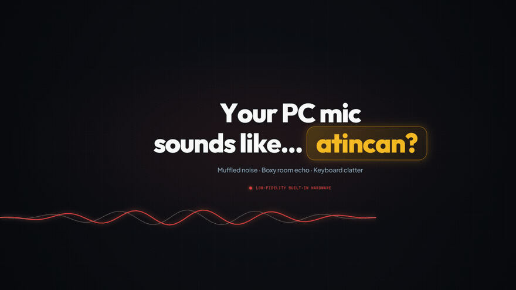

<p align="center">
  <a href="https://fuziwaradesu67.github.io/EZmic/" target="_blank">
    
  </a>
</p>

<p align="center">
  <a href="https://fuziwaradesu67.github.io/EZmic/"></a>
  <a href="https://github.com/FuziwaraDesu67/EZmic/releases/download/v1.1.8/EZmic-v1.1.8-Setup.exe"></a>
  <a href="https://github.com/FuziwaraDesu67/EZmic/releases/download/v1.1.8/EZmic-v1.1.8.apk"></a>
  <a href="https://github.com/FuziwaraDesu67/EZmic/releases/download/v1.1.8/EZmic-v1.1.8-win64.exe"></a>
  <a href="https://buymeacoffee.com/eaadarsh"></a>
  <a href="https://github.com/FuziwaraDesu67/EZmic/blob/main/LICENSE"></a>
</p>

# EZmic 🎙️⚡

> **Turn your Android smartphone into a studio-grade, ultra-low latency microphone for your Windows PC over Wi-Fi, USB, or Bluetooth.**  
> *Created with ❤️ by [@FuziwaraDesu67](https://github.com/FuziwaraDesu67) • [☕ Buy me a coffee](https://buymeacoffee.com/eaadarsh) • [🌐 Live Interactive Showcase](https://fuziwaradesu67.github.io/EZmic/)*

Works out of the box with **Discord**, **OBS Studio**, **Zoom**, **Audacity**, and **Steam Games** with zero third-party tools.

---

## 🎨 What's New in v1.1.8 (Figma Obsidian & Mint Redesign + Bundled Driver) 🚀

- 🎨 **Figma Obsidian & Mint Studio UI**: Complete design overhaul across the Windows companion and Android Jetpack Compose app. Features deep obsidian backgrounds (`#0C0E11`), mint accents (`#2EE59D`), segmented connection docks, and dark custom ComboBox menus.
- 🎙️ **Bundled Zero-Config Virtual Microphone**: Completely eliminated external VB-CABLE downloads. The virtual driver is bundled silently inside `EZmic-Setup.exe` and registers directly into Windows CoreAudio.
- 🏷️ **Native "EZmic Virtual Microphone" in Discord & Games**: Endpoints are automatically named **`EZmic Virtual Microphone`** (Recording/Input) and **`EZmic Audio Cable`** (Playback/Output) system-wide via native Win32 APIs.
- 🛡️ **Zero-Lock Setup Installer**: Installer automatically terminates active instances (`KillRunningApp()`), eliminating file-locking conflicts (`code 32`).
- 🔄 **In-App Updater Redirect Fix**: Android client follows HTTP 301/302 redirects with live progress bar.

---

## 🛡️ What's New in v1.1.7 (Protocol V2 & Security Audit Protections)

- 🔐 **Protocol V2 Authenticated Sessions (`MIC2`)**: Ephemeral 32-bit session tokens protect against rogue UDP packet injection and unauthenticated session lockouts.
- 📡 **Direct Query Handshake Listener**: UDP direct-query listener (`UDP 49150`) negotiates tokens even across routers with AP isolation or blocked broadcast traffic.
- ⏱️ **Fast Lockout Recovery**: Lowered idle session handover timeout from 8.0s to 2.5s for instant reconnection on Wi-Fi network hops.
- 🔒 **USB Loopback Guard**: Initial read timeout and header magic validation prevent idle TCP connections from stalling the loopback listener.
- 🛡️ **Auto-Updater PE & Origin Verification**: Download URLs strictly validated to official GitHub releases/assets HTTPS domains; validates DOS `MZ` and PE signatures before launching.

---

## ⚡ Why EZmic?

- **Zero Third-Party Downloads**: Virtual driver is bundled and configured automatically.
- **1 Single Executable, 1 Single APK**: No .NET installation required, no Android Studio or SDK required.
- **Embedded ADB**: USB low-latency mode works automatically without needing command-line tools.
- **Hardware Rack Console UI**: Built with a 24-segment discrete LED ladder VU meter, ballistic decay, decibel readout, and live ON AIR tally.
- **Tri-Mode Connectivity**:
  - **Wi-Fi**: Automatic subnet beacon discovery (`UDP 49150/49152`) with Client IP Pinning.
  - **USB Cable**: Hardware ADB tunnel with ultra-low **~5ms latency** bound strictly to loopback.
  - **Bluetooth**: Direct RFCOMM streaming without needing a local Wi-Fi router.
- **WASAPI Shared Mode Engine**: Native Windows Audio Session API eliminates driver crashes and supports all multi-channel devices.
- **Studio Audio Quality**: 48,000 Hz, 16-bit PCM lossless stereo duplication with Shure SM7B voice enhancer curve, real-time noise gating, and gain control.

---

## 🚀 60-Second Quick Start

### Step 1: Download the Files
Grab the latest release from the **[Releases Page](https://github.com/FuziwaraDesu67/EZmic/releases/latest)**:
- 💻 **Windows PC (Installer)**: [**Download EZmic-v1.1.8-Setup.exe**](https://github.com/FuziwaraDesu67/EZmic/releases/download/v1.1.8/EZmic-v1.1.8-Setup.exe) *(Recommended, bundles driver)*
- 💻 **Windows PC (Portable)**: [**Download EZmic-v1.1.8-win64.exe**](https://github.com/FuziwaraDesu67/EZmic/releases/download/v1.1.8/EZmic-v1.1.8-win64.exe) *(Single-file standalone)*
- 📱 **Android Phone**: [**Download EZmic-v1.1.8.apk**](https://github.com/FuziwaraDesu67/EZmic/releases/download/v1.1.8/EZmic-v1.1.8.apk) *(Native app, high quality)*

### Step 2: Open EZmic PC
1. Run `EZmic-v1.1.8-Setup.exe` (or launch the portable executable).
2. The virtual driver configures automatically as **`EZmic Virtual Microphone`**.
3. Select your desired connection mode (**Wi-Fi**, **USB**, or **Bluetooth**) and click **Start receiver**.

### Step 3: Start Streaming on Phone
1. Open the **EZmic** app on your phone.
2. Choose matching mode:
   - **Wi-Fi**: Tap **Auto-detect PC** (finds your PC automatically), then tap **Start broadcast**.
   - **USB**: Plug in USB cable with USB Debugging enabled, then tap **Start broadcast**.
   - **Bluetooth**: Pick your paired PC from the dropdown, then tap **Start broadcast**.
3. Watch the 24-segment LED VU meter dance live on both screens!

### Step 4: Route to Discord, Games, or OBS
In Discord / OBS / Game Audio Settings:
- Set **Input Device (Microphone)** to: **`EZmic Virtual Microphone`**.
- Speak into your phone — your PC hears you crystal clear!

---

## 🔌 Connection Modes Detailed

| Mode | Latency | Stability | Ideal Use Case |
|---|---|---|---|
| **USB (ADB)** | **~5 ms** | 100% Rock-Solid (Loopback isolated) | Gaming, competitive voice chat, live streaming |
| **Wi-Fi** | ~15–25 ms | Excellent (Client IP Pinned) | Wireless freedom across your room/desk |
| **Bluetooth** | ~35–50 ms | High (Secure RFCOMM Service) | On-the-go or when no Wi-Fi router is available |

---

## 🏗️ Technical Architecture

```
[ Android Microphone (Samsung/Pixel/etc.) ]
                │
         48kHz 16-bit PCM
     (VOICE_RECOGNITION DSP)
                │
   ┌─────────────┼─────────────┐
   ▼             ▼             ▼
Wi-Fi UDP    USB ADB TCP   Bluetooth RFCOMM
(Port 49152) (Port 49153)  (Dedicated UUID)
(IP Pinned)  (127.0.0.1)          │
   │             │                 │
   └─────────────┼─────────────────┘
                 │
                 ▼
[ Windows Mic Companion (WASAPI Shared) ]
                 │
         48kHz Stereo Float/PCM
         (Shure SM7B Warmth DSP)
                 │
                 ▼
[ EZmic Audio Cable (Playback) ]
                 │
                 ▼
[ EZmic Virtual Microphone (Recording) ]
                 │
                 ▼
[ Discord / OBS / Steam Games / Zoom ]
```

---

## 🛠️ Building from Source

### Windows Companion
Requirements: .NET 8 / 9 SDK
```powershell
cd windows/MicCompanion
# Single-file standalone publish
dotnet publish -c Release -r win-x64 --self-contained true -p:PublishSingleFile=true -p:IncludeNativeLibrariesForSelfExtract=true -o "../../dist/pc"
```

### Android App
Requirements: Android Studio / JDK 17+
```bash
cd android
./gradlew assembleDebug
# APK is generated at: app/build/outputs/apk/debug/app-debug.apk
```

---

## ☕ Support & Donations

If EZmic has been useful to you, you can support further development by buying a coffee:

[](https://buymeacoffee.com/eaadarsh)

Direct link: **[buymeacoffee.com/eaadarsh](https://buymeacoffee.com/eaadarsh)**

---

## 👨‍💻 Author & Contributions

Created and maintained by **[@FuziwaraDesu67](https://github.com/FuziwaraDesu67)**.  
Contributions, bug reports, and feature requests are welcome on [GitHub Issues](https://github.com/FuziwaraDesu67/EZmic/issues)!

---

## 📜 License
MIT License. Free for personal and commercial use.
