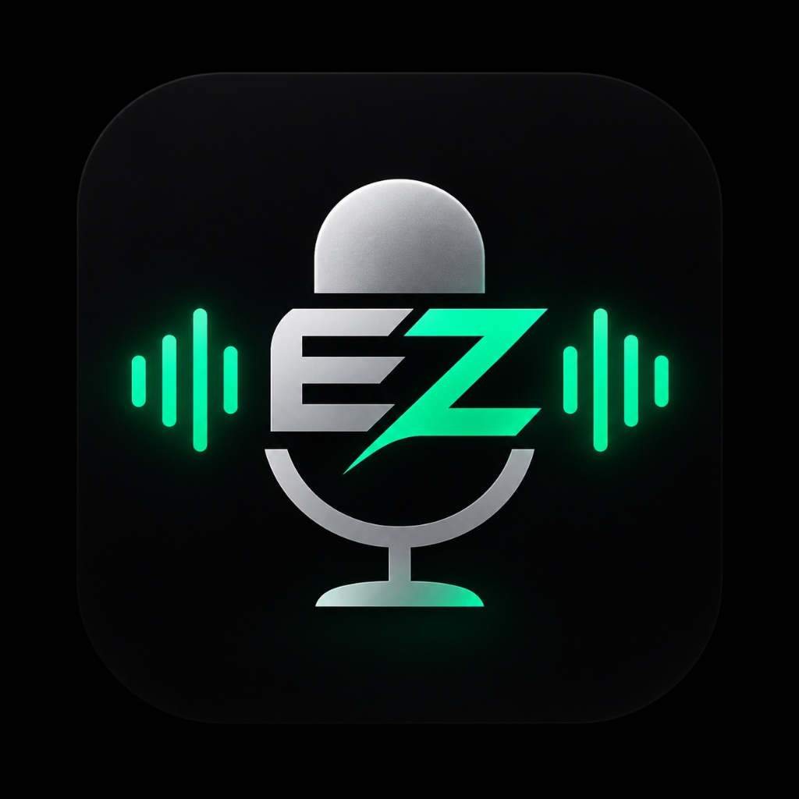

<p align="center">
  
</p>

# EZmic 🎙️⚡

> **Turn your Android smartphone into a high-fidelity, ultra-low latency microphone for your Windows PC over Wi-Fi, USB, or Bluetooth.**

Works out of the box with **Discord**, **OBS Studio**, **Zoom**, **Audacity**, and **Steam Games** with zero complex setup.

---

## ⚡ Why EZmic?

- **1 Single Executable, 1 Single APK**: No .NET installation required, no Android Studio or SDK required.
- **Embedded ADB**: USB low-latency mode works automatically without needing command-line tools.
- **1-Click Virtual Cable Setup**: Built-in free driver installer helper right inside the desktop interface.
- **Hardware Rack Console UI**: Built with a 24-segment discrete LED ladder VU meter, ballistic decay, decibel readout, and live ON AIR tally.
- **Tri-Mode Connectivity**:
  - **Wi-Fi**: Automatic subnet beacon discovery (`UDP 49150/49152`).
  - **USB Cable**: Hardware ADB tunnel with ultra-low **~5ms latency**.
  - **Bluetooth**: Direct RFCOMM streaming without needing a local Wi-Fi router.
- **WASAPI Shared Mode Engine**: Native Windows Audio Session API eliminates driver crashes and supports all multi-channel devices.
- **Studio Audio Quality**: 48,000 Hz, 16-bit PCM lossless stereo duplication with hardware noise suppression & echo cancellation.

---

## 🚀 60-Second Quick Start

### Step 1: Download the Files
Go to the **[Releases](../../releases)** page (or grab from the `release/` folder):
1. **Windows PC**: Download [`EZmic-v1.0-win64.exe`](release/EZmic-v1.0-win64.exe)
2. **Android Phone**: Download [`EZmic-v1.0.apk`](release/EZmic-v1.0.apk)

### Step 2: Open EZmic PC
1. Double-click `EZmic-v1.0-win64.exe` on your PC.
2. If you don't already have a virtual audio cable, the app will show a yellow banner:  
   👉 Click **"Install Free Cable"** (it downloads and installs VB-Audio Cable automatically in 10 seconds).
3. Select your desired connection mode (**Wi-Fi**, **USB**, or **Bluetooth**) and click **Start receiver**.

### Step 3: Start Streaming on Phone
1. Open the **EZmic** app on your phone.
2. Choose matching mode:
   - **Wi-Fi**: Tap **Auto-detect PC** (finds your PC automatically), then tap **Start broadcast**.
   - **USB**: Plug in USB cable with USB Debugging enabled, then tap **Start broadcast**.
   - **Bluetooth**: Pick your paired PC from the dropdown, then tap **Start broadcast**.
3. Watch the 24-segment LED VU meter dance live on both screens!

### Step 4: Route to Discord, Games, or OBS
In Discord / OBS / Game Audio Settings:
- Set **Input Device (Microphone)** to: **`CABLE Output (VB-Audio Virtual Cable)`**.
- Speak into your phone — your PC hears you crystal clear!

---

## 🔌 Connection Modes Detailed

| Mode | Latency | Stability | Ideal Use Case |
|---|---|---|---|
| **USB (ADB)** | **~5 ms** | 100% Rock-Solid | Gaming, competitive voice chat, live streaming |
| **Wi-Fi** | ~15–25 ms | Excellent | Wireless freedom across your room/desk |
| **Bluetooth** | ~35–50 ms | High | On-the-go or when no Wi-Fi router is available |

### Enabling USB Mode (5ms Latency)
1. On your Android phone, go to **Settings** > **About phone** > tap **Build number** 7 times to enable Developer Options.
2. Go to **Settings** > **Developer options** > enable **USB debugging**.
3. Connect your phone with a USB cable. When prompted *"Allow USB debugging?"*, tap **Allow** (check *"Always allow"*).
4. That's it! The PC companion detects your phone automatically.

---

## 🏗️ Technical Architecture

```
[ Android Microphone (Samsung/Pixel/etc.) ]
                │
         48kHz 16-bit PCM
     (VOICE_RECOGNITION DSP)
                │
  ┌─────────────┼─────────────┐
  ▼             ▼             ▼
Wi-Fi UDP    USB ADB TCP   Bluetooth RFCOMM
(Port 49152) (Port 49153)  (Custom GUID)
  │             │             │
  └─────────────┼─────────────┘
                │
                ▼
[ Windows Mic Companion (WASAPI Shared) ]
                │
        48kHz Stereo Float/PCM
                │
                ▼
[ VB-Audio Virtual Cable (CABLE Input) ]
                │
                ▼
[ Discord / OBS / Steam Games / Zoom ]
```

### Protocol Specification
- **Magic Header**: `0x4D494331` (`"MIC1"`)
- **Header Structure**: 12-byte binary header (`Magic`, `SequenceNumber`, `TimestampMs`, `CodecType`, `Flags`, `PayloadLength`).
- **Framing**: 20ms audio frames (960 samples @ 48kHz).
- **Format**: 16-bit Little-Endian Mono PCM automatically upmixed to Stereo `(L, R)` pairs in Windows WASAPI to match virtual soundcards.

---

## 🛠️ Building from Source

### Windows Companion
Requirements: .NET 8 SDK
```powershell
cd windows/MicCompanion
# Single-file standalone publish
dotnet publish -c Release -r win-x64 --self-contained true -p:PublishSingleFile=true -p:IncludeNativeLibrariesForSelfExtract=true -o "../../dist/pc"
```

### Android App
Requirements: Android Studio / JDK 17+
```bash
cd android
./gradlew assembleDebug
# APK is generated at: app/build/outputs/apk/debug/app-debug.apk
```

---

## 📜 License
MIT License. Free for personal and commercial use.
